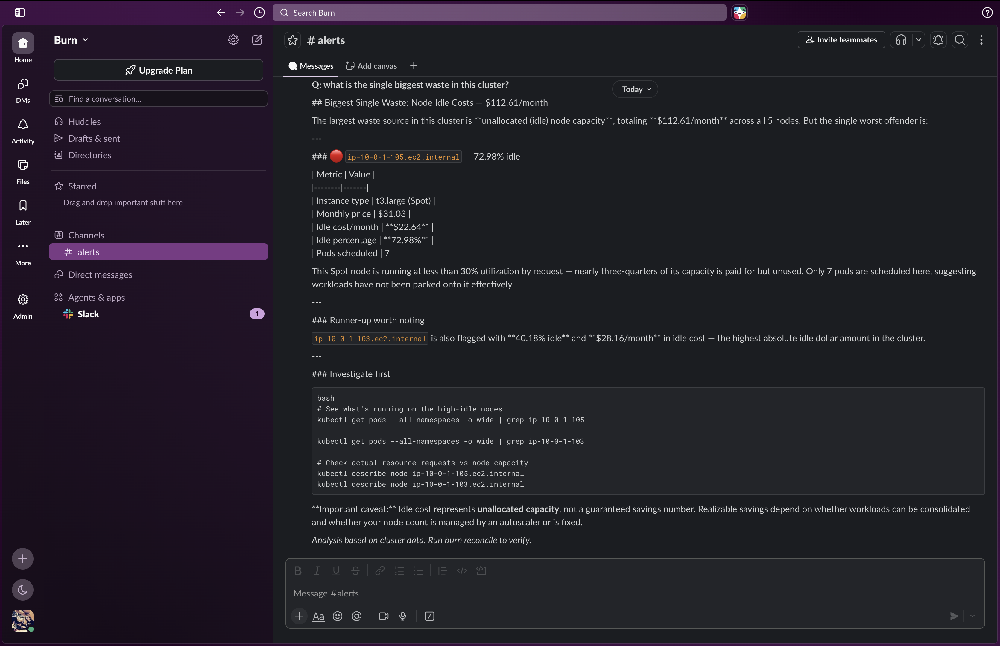
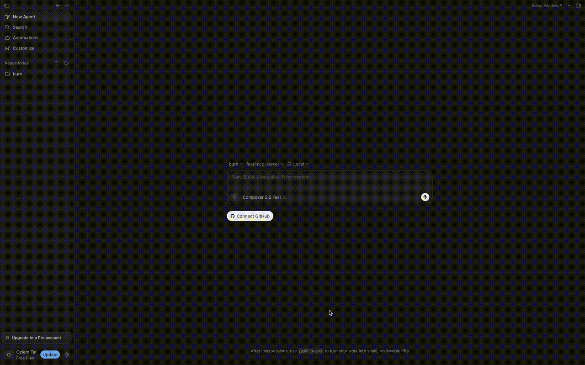

# burn

[](https://github.com/tanrikuluozlem/burn/actions/workflows/ci.yml)
[](https://github.com/tanrikuluozlem/burn/releases)
[](https://goreportcard.com/report/github.com/tanrikuluozlem/burn)
[](LICENSE)

Your Kubernetes cluster is burning money. Find out where.


No agent to deploy. No dashboard to maintain. No YAML to configure. Just install and run.

[](https://youtu.be/uGVvaKXeTf4)

## Why burn

- **Zero setup**: `brew install`, run one command, get answers. No cluster agent, no persistent storage, no config files.
- **Full cost coverage**: Compute, storage, load balancers, and GPU costs with cloud pricing.
- **Billing reconciliation**: Verify cost estimates against your real AWS CUR or Azure Cost Management bill. Per node, per disk, per load balancer.
- **SP/RI/Spot detection**: See which nodes have Savings Plan, Reserved Instance, or Spot coverage. Coverage gaps show 1-year RI pricing opportunities from AWS and Azure APIs.
- **Optimization insights**: Find rightsizing, Spot, and consolidation opportunities, using historical P95 usage when available.
- **Orphaned resource detection**: Find billed disks and load balancers with no matching Kubernetes resource.
- **AI-powered**: Ask questions in plain English, get recommendations with investigation commands.
- **Slack-native**: `/burn` for instant cost reports. `/burn reconcile` for billing verification. `/burn ask "..."` for AI analysis.
- **Cloud + on-prem**: Works with AWS EKS, Azure AKS, GCP GKE, and on-premise clusters. Billing reconciliation supports AWS and Azure.
- **Spot readiness**: Identifies which workloads pass spot-readiness checks, with discount and interruption data.
- **Ingress LB detection**: Detects load balancers from both Services and Ingress resources, with hostname deduplication.
- **MCP server**: Use burn from Claude Code, Cursor, or any MCP-compatible AI agent. Ask questions, get cost data.
- **Time-aware**: `--period 7d` for weekly averages instead of point-in-time snapshots.

## Install

```bash
# Homebrew
brew install tanrikuluozlem/burn/burn

# Upgrade
brew upgrade tanrikuluozlem/burn/burn

# Binary
VERSION=$(curl -s https://api.github.com/repos/tanrikuluozlem/burn/releases/latest | grep tag_name | cut -d'"' -f4 | tr -d 'v') && \
curl -L "https://github.com/tanrikuluozlem/burn/releases/latest/download/burn_${VERSION}_$(uname -s | tr '[:upper:]' '[:lower:]')_$(uname -m | sed 's/x86_64/amd64/;s/aarch64/arm64/').tar.gz" | tar xz

# Docker
docker pull ghcr.io/tanrikuluozlem/burn:latest

# Helm
git clone https://github.com/tanrikuluozlem/burn.git
helm install burn ./burn/charts/burn

# Go
go install github.com/tanrikuluozlem/burn/cmd/burn@latest
```

> **macOS:** If you see a Gatekeeper warning, run: `sudo xattr -d com.apple.quarantine $(which burn)`

## Quick start

```bash
# Cost breakdown (without Prometheus)
burn analyze

# With Prometheus (pass your Prometheus URL)
burn analyze --prometheus http://prometheus:9090

# 7-day average
burn analyze --prometheus http://prometheus:9090 --period 7d

# Drill into a namespace
burn analyze --prometheus http://prometheus:9090 --namespace argocd

# Spot readiness
burn analyze --prometheus http://prometheus:9090 --spot
```

## Billing reconciliation

Every cost tool estimates. Burn checks it against your actual cloud bill.

### AWS (CUR via Athena)


```bash
# Pass CUR config as flags
burn reconcile \
  --cur-database my_cur_db \
  --cur-table data \
  --cur-output s3://my-bucket/athena-results/ \
  --cur-region us-east-1

# Or use environment variables
export CUR_DATABASE=my_cur_db CUR_TABLE=data
export CUR_OUTPUT_LOCATION=s3://my-bucket/athena-results/ CUR_REGION=us-east-1
burn reconcile
```

### Azure (Cost Management API)


```bash
# Pass subscription as flag
burn reconcile --provider azure \
  --azure-subscription YOUR-SUBSCRIPTION-ID

# Or use environment variable
export AZURE_SUBSCRIPTION_ID=YOUR-SUBSCRIPTION-ID
burn reconcile --provider azure
```

What you get:
- Per-node estimated vs actual cost with dollar difference
- Savings Plan, Reserved Instance, and Spot pricing detected per node, including partial coverage
- Coverage gaps with 1-year RI pricing from AWS and Azure pricing APIs
- Orphaned disks and load balancers in your bill with no matching K8s resource
- OS disk costs separated from data disks
- Public IP costs itemized
- Namespace cost allocation (proportional or AWS split cost allocation)
- EKS/AKS management fees tracked separately
- Data transfer cost per node

Works with both Legacy CUR and CUR 2.0. Run `burn reconcile --setup` for step-by-step setup instructions.

Verified against AWS Cost Explorer and Azure Cost Management portal.

### AI-powered reconciliation analysis


```bash
burn reconcile --provider aws --ai
```

Shows why your estimated and actual costs differ, with commands to investigate each issue.

### Automation

```bash
# Pipe JSON output to your monitoring or alerting pipeline
burn reconcile --provider aws -o json | jq .total_actual_cost
```

## Budgets and calendar-month forecasting

`MonthlyCost` elsewhere in burn is the **current hourly rate × 730** — a
run-rate, not a calendar-month total and not month-to-date spend. Budgets and
forecasting add the missing pieces, from snapshots burn records locally:

```bash
# Each scheduled run appends the current hourly cost, so successive runs accrue
burn analyze --prometheus http://prometheus:9090 \
  --snapshot-path /var/lib/burn/snapshots.json \
  --budget budgets.json \
  --budget-gap-threshold 120   # hourly runs: gaps are >2h, not a missing hour

# Evaluate without writing a snapshot (e.g. ad-hoc check)
burn analyze --snapshot-path /var/lib/burn/snapshots.json --budget budgets.json --budget-no-save
```

`budgets.json`:

```json
[
  {"name": "cluster", "amount": 4000, "thresholds": [0.8, 1.0]},
  {"name": "app", "namespace": "app-backend", "amount": 1200, "thresholds": [0.9]}
]
```

What the output adds:

- **Month-to-date accrual** — snapshots are point observations of hourly cost,
  integrated piecewise-constant between adjacent records. Intervals longer than
  the gap threshold (default 30m) are reported as gaps and reduce coverage
  instead of being counted as spend. A first run mid-month leaves the earlier
  month **unknown, not zero**, and says so.
- **Calendar-month forecast** — known month-to-date plus the remaining calendar
  hours at the forecast rate. Month length is the real UTC month (28–31 days,
  29 in a leap February); 730 is not used. The rate is the current hourly cost or
  a linear trend over recent daily means (clamped at zero; falls back to the
  current rate with an explanation when there are too few samples).
- **Trend** — the trailing window vs the immediately preceding equal window,
  with change amount and percent. A zero previous window is reported as
  **not comparable**; differing coverage is flagged, never backfilled; new
  namespaces are marked.
- **Budget status** — states in priority order: `overspent` (actual),
  `forecast_overspent`, `near_budget`, `normal`, and `insufficient_data`. A
  threshold `T` is reached at `>= T`. Low coverage never publishes a confident
  "under budget": such results are marked insufficient with a credible range.

Snapshots are a single local JSON file (no external storage). Writes are locked
and atomic, concurrent writers do not lose records, and a corrupt or truncated
file is left in place with an error rather than silently rebuilt.

Notifications (via Slack) fire on a level increase, do not repeat at the same
level, and fire again after a decrease and re-increase. The stored level resets
each UTC month.

## Spot readiness


Spot discount and interruption data.

## AI recommendations

Get cluster-wide or namespace-specific recommendations:

```bash
burn analyze --prometheus http://prometheus:9090 --period 7d --ai
burn analyze --prometheus http://prometheus:9090 --namespace app-backend --ai
burn ask --prometheus http://prometheus:9090 "why is argocd so expensive?"
```

### Ask questions in plain English


Requires `ANTHROPIC_API_KEY` environment variable.

## Slack integration

Run burn as a Slack bot:

```bash
burn serve --port 8080 --prometheus http://prometheus:9090 --period 7d
```

| Command | What you get |
|---------|-------------|
| `/burn` | Full cost report: nodes, namespaces, idle cost, LB, storage |
| `/burn ns argocd` | Pod-level breakdown for a namespace |
| `/burn budget` | Month-to-date, calendar-month forecast, trend, and budget status |
| `/burn reconcile --provider aws` | Estimated vs actual billing, SP/RI/Spot detection |
| `/burn reconcile --provider azure` | Estimated vs actual billing, SP/RI/Spot detection |
| `/burn ask "what is the single biggest waste?"` | AI analysis with investigation commands |



### Slack setup

1. Create a Slack App at https://api.slack.com/apps
2. Add Slash Command: `/burn` → point to your server URL + `/slack`
3. Set `SLACK_SIGNING_SECRET` and `ANTHROPIC_API_KEY` environment variables
4. Expose the server (e.g., ngrok for testing, load balancer for production)

## MCP server

Use burn from Claude Code, Cursor, or any MCP-compatible AI agent. Three tools: `analyze`, `spot_readiness`, `reconcile`.

### Claude Code


```bash
claude mcp add burn -e AWS_PROFILE=your-profile \
  -e CUR_DATABASE=your_cur_db -e CUR_TABLE=data \
  -e CUR_OUTPUT_LOCATION=s3://your-bucket/athena-results/ \
  -e CUR_REGION=us-east-1 \
  -- burn mcp --prometheus http://prometheus:9090
```

Then ask:

```
I need to cut our Kubernetes costs by 20%, where do I start?
verify that against my actual AWS bill, I don't trust estimates
show me the spot details, what breaks if we switch?
```

### Cursor



Add to `~/.cursor/mcp.json`:

```json
{
  "mcpServers": {
    "burn": {
      "command": "burn",
      "args": ["mcp", "--prometheus", "http://prometheus:9090"],
      "env": {
        "AWS_PROFILE": "your-profile",
        "CUR_DATABASE": "your_cur_db",
        "CUR_TABLE": "data",
        "CUR_OUTPUT_LOCATION": "s3://your-bucket/athena-results/",
        "CUR_REGION": "us-east-1"
      }
    }
  }
}
```

CUR environment variables are optional, only needed for `reconcile`. Without them, `analyze` and `spot_readiness` work out of the box.

## On-prem and GPU clusters

Burn works with on-premise and GPU clusters. Set your own resource rates:

```bash
burn analyze \
  --cpu-price 0.05 \
  --ram-price 0.008 \
  --gpu-price 3.00 \
  --storage-price 0.10
```

Without custom pricing, cloud-equivalent rates are used as defaults.

## How it works

```
Kubernetes API   → nodes, pods, PVCs, services, ingresses
Prometheus       → actual CPU & memory usage (optional)
Cloud Pricing    → VM, storage, GPU, and RI pricing (AWS, Azure live APIs; GCP embedded)
AWS CUR / Azure  → actual billing data for reconciliation (optional)
         ↓
    Cost Engine  → estimates, reconciliation, SP/RI/Spot detection
         ↓
    CLI / Slack / MCP / AI Recommendations
```

### Pricing sources

| Priority | Source | When |
|----------|--------|------|
| 1 | AWS/Azure pricing API | Live, region-aware when credentials are available |
| 2 | Embedded pricing DB | AWS, Azure, and GCP instances; AWS and Azure updated weekly via CI |
| 3 | Static fallback | Estimates based on instance family for unknown types |

Storage and load balancer costs are fetched from cloud APIs when available, with static fallbacks. Usage-based charges (data processing, LCU) depend on traffic volume and are not included. GPU nodes are detected automatically and priced via ratio-based cost splitting.

## Deploy to Kubernetes

### Helm

```bash
git clone https://github.com/tanrikuluozlem/burn.git

# Create secrets
kubectl create secret generic burn-secrets \
  --from-literal=slack-webhook-url=https://hooks.slack.com/services/YOUR/WEBHOOK/URL \
  --from-literal=anthropic-api-key=sk-ant-YOUR-KEY

# Install
helm install burn ./burn/charts/burn \
  --set prometheus.url=http://prometheus:9090 \
  --set schedule="0 9 * * 1-5"
```

On EKS with IRSA (for AWS pricing and CUR access):

```bash
helm install burn ./burn/charts/burn \
  --set prometheus.url=http://prometheus:9090 \
  --set schedule="0 9 * * 1-5" \
  --set serviceAccount.annotations."eks\.amazonaws\.com/role-arn"=arn:aws:iam::ACCOUNT:role/burn
```

The chart includes RBAC (ClusterRole with read-only access to nodes, pods, services, PVCs, PVs, ingresses, deployments, statefulsets, daemonsets, and PDBs). Disable with `--set rbac.create=false`.

### CronJob (daily Slack reports)

```yaml
apiVersion: batch/v1
kind: CronJob
metadata:
  name: burn-report
spec:
  schedule: "0 9 * * 1-5"
  jobTemplate:
    spec:
      template:
        spec:
          containers:
          - name: burn
            image: ghcr.io/tanrikuluozlem/burn:latest
            args:
            - analyze
            - --prometheus
            - http://prometheus-server.monitoring:80
            - --period
            - 7d
            - --ai
            - --slack
            env:
            - name: ANTHROPIC_API_KEY
              valueFrom:
                secretKeyRef:
                  name: burn-secrets
                  key: anthropic-api-key
            - name: SLACK_WEBHOOK_URL
              valueFrom:
                secretKeyRef:
                  name: burn-secrets
                  key: slack-webhook-url
          restartPolicy: OnFailure
```

## Configuration

| Variable | Description | Required for |
|----------|-------------|-------------|
| `ANTHROPIC_API_KEY` | Claude API key | `--ai`, `ask`, `serve` |
| `SLACK_WEBHOOK_URL` | Slack webhook URL | `--slack` |
| `SLACK_SIGNING_SECRET` | Slack app signing secret | `serve` |
| `CUR_DATABASE` | Athena database name | `reconcile` (AWS) |
| `CUR_TABLE` | Athena table name | `reconcile` (AWS) |
| `CUR_OUTPUT_LOCATION` | S3 path for Athena results | `reconcile` (AWS) |
| `CUR_WORKGROUP` | Athena workgroup (default: primary) | `reconcile` (AWS) |
| `CUR_REGION` | AWS region for Athena | `reconcile` (AWS) |
| `AZURE_SUBSCRIPTION_ID` | Azure subscription ID | `reconcile` (Azure) |
| `BURN_SNAPSHOT_PATH` | Local snapshot file | `serve` (`/burn budget`) |
| `BURN_BUDGET_FILE` | JSON budgets file | `serve` (`/burn budget`) |

| Flag | Description |
|------|-------------|
| `--cpu-price` | CPU cost per core per hour (on-prem) |
| `--ram-price` | RAM cost per GiB per hour (on-prem) |
| `--gpu-price` | GPU cost per unit per hour (on-prem) |
| `--storage-price` | Storage cost per GiB per month (on-prem) |
| `--spot` | Show spot instance readiness details |
| `--provider` | Cloud provider for reconciliation (`aws` or `azure`) |
| `--days` | Number of days to reconcile (default: 7) |
| `--cost-type` | Azure cost type: `amortized` or `actual` (default: amortized) |
| `--data-delay` | Billing data delay in hours (default: 48; AWS CUR ~24h, Azure EA/MCA 8-24h, Azure PAYG up to 72h) |
| `--snapshot-path` | Local snapshot file for month-to-date accrual/forecast |
| `--budget` | Path to a JSON budgets file |
| `--budget-no-save` | Evaluate budgets without appending a snapshot |
| `--budget-gap-threshold` | Minutes without a snapshot before an interval counts as a gap (default: 30; set above your snapshot cadence, e.g. 120 for hourly runs) |
| `--budget-window-days` | Window length for adjacent-window trend comparison (default: 7) |
| `--budget-trend-days` | Days of daily means used for the linear trend (default: 7) |
| `--budget-min-samples` | Minimum daily samples before a trend is used (default: 3) |
| `--budget-min-coverage` | Minimum month coverage before budget conclusions are trusted (default: 0.9) |

AWS and Azure clusters use live cloud pricing automatically. GCP clusters use embedded pricing. On-prem pricing flags are for clusters where cloud pricing is not available.

## Development

```bash
make build    # Build binary
make test     # Run tests
```

## License

Apache 2.0. See [LICENSE](LICENSE) for details.
